# Module 2 Group Assignment

CSCI 5117, Fall 2026, [assignment description](https://canvas.umn.edu/courses/579310/pages/project-2)

## App Info:

* Team Name: HARMless
* App Name: TODO
* App Link: <https://TODO.com/>

### Students

* Amelia Vrieze, vriez051@umn.edu
* ...

## Key Features

**Describe the most challenging features you implemented
(one sentence per bullet, maximum 4 bullets):**

* ...

Which (if any) device integration(s) does your app support?

* ...

Which (if any) progressive web app feature(s) does your app support?

* ...

## Mockup images

<!-- **[Add images/photos that show your mockup](https://stackoverflow.com/questions/10189356/how-to-add-screenshot-to-readmes-in-github-repository) along with a very brief caption:** -->

[Link to Figma](https://www.figma.com/design/gbpX9Qh82GEYrpzjKzrwg2/5117--HARMless?node-id=578-2463&t=WlTZcjI9t9yDhzQg-0)

### Splash page (load screen), Signup, and Login
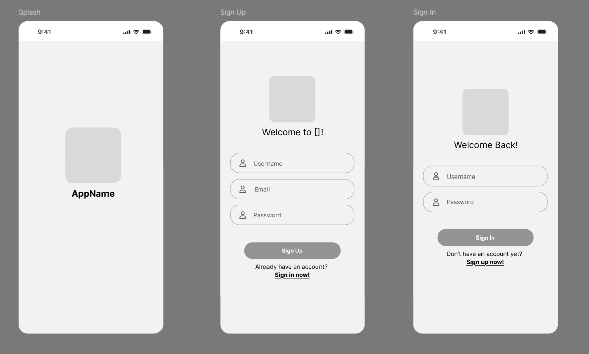

### Home page
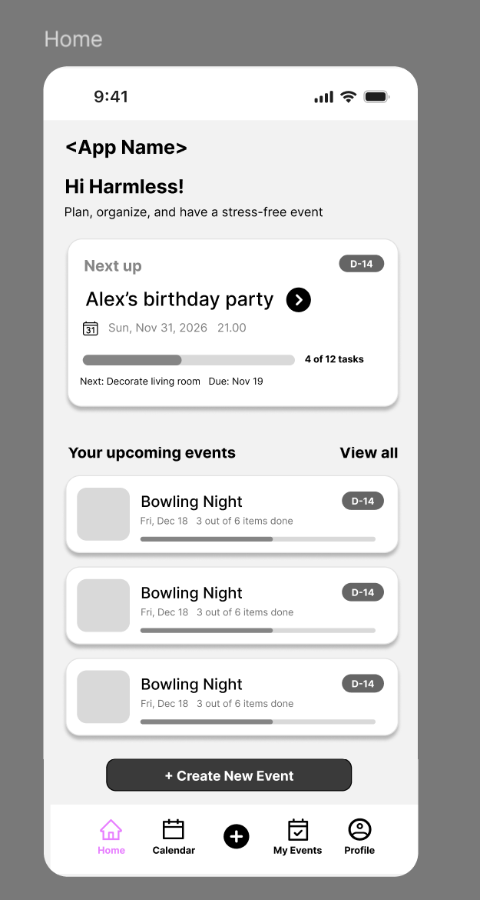

### Calendar view
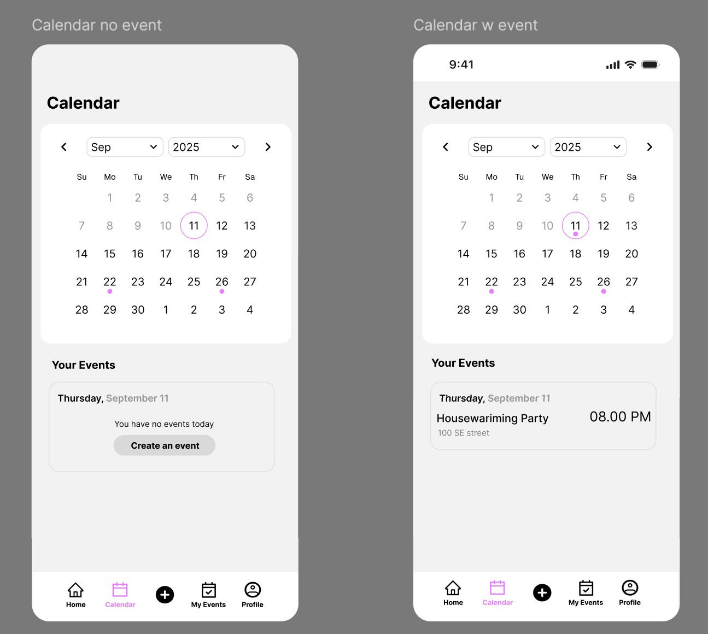

### Set up an event
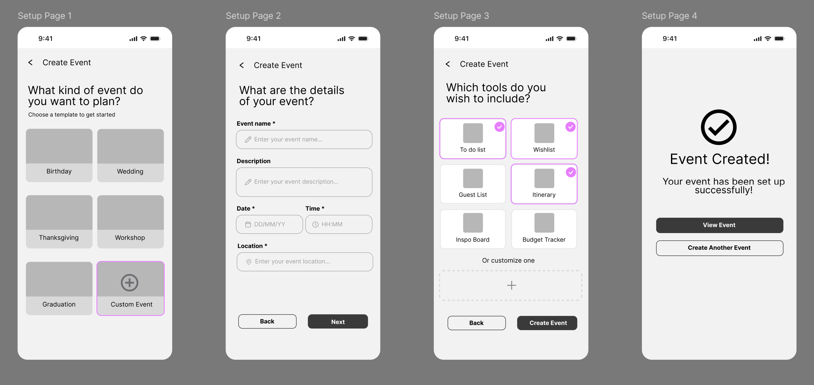

### Delete an event
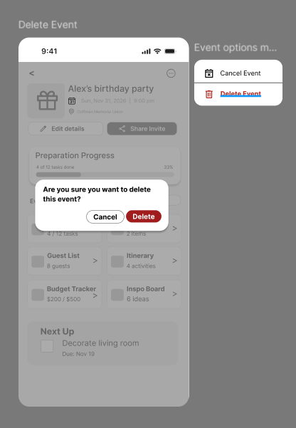

### View/Modify event details
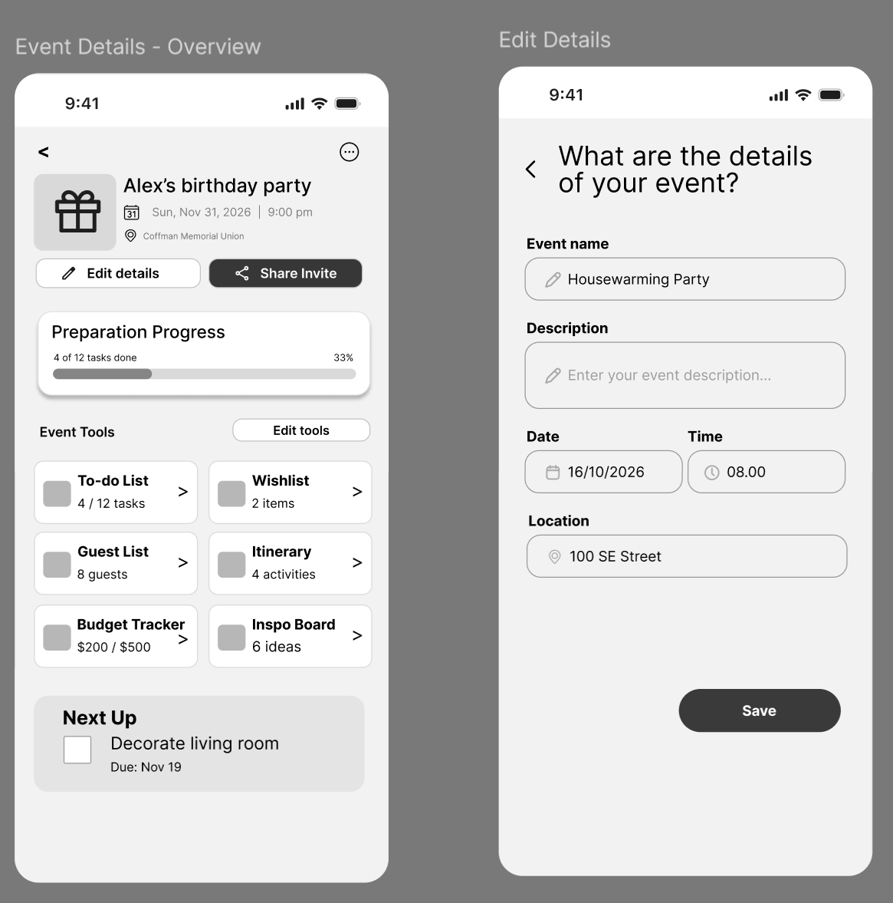

### Todo list
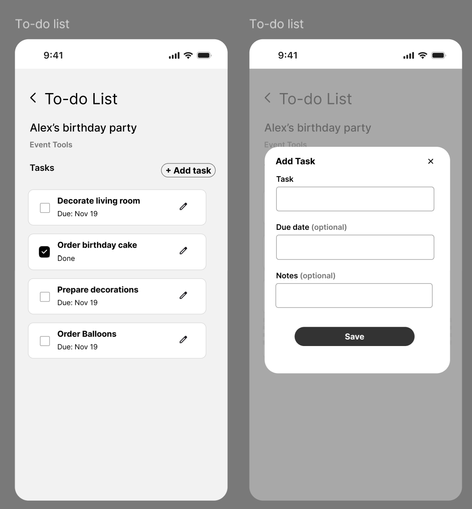

### Wishlist
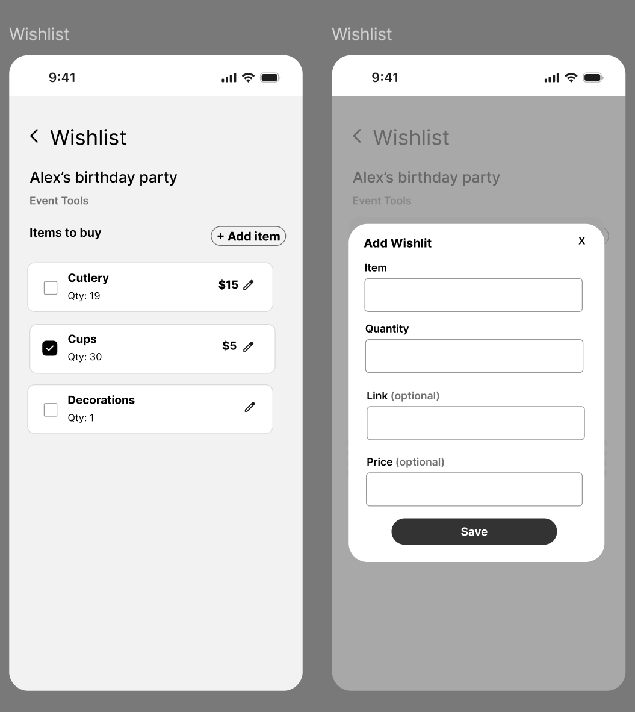

### Guest list
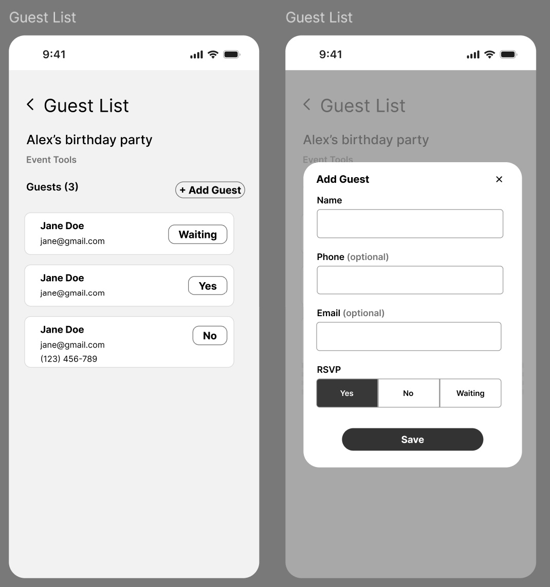

### Itinerary
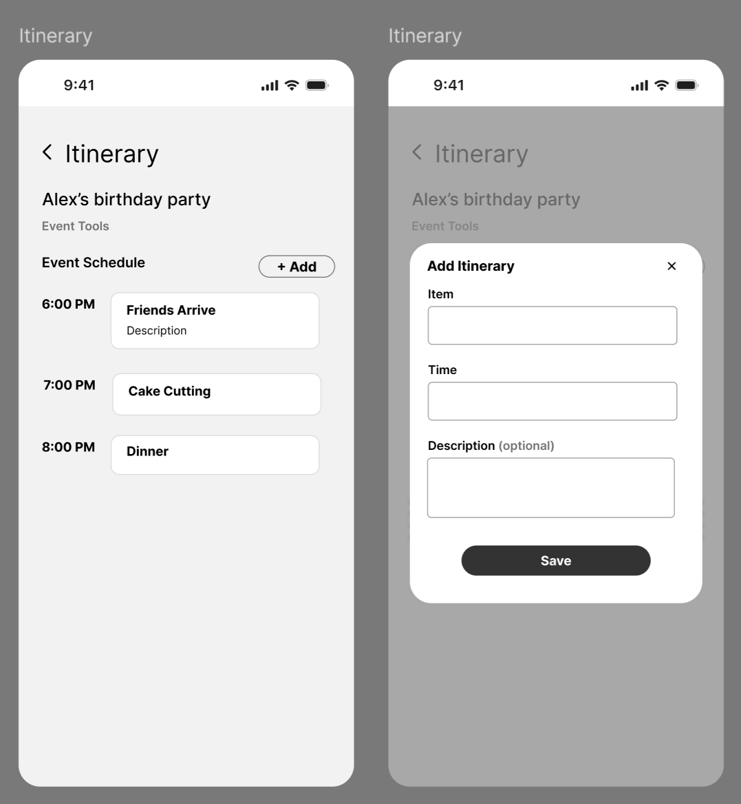

### Budget Tracking
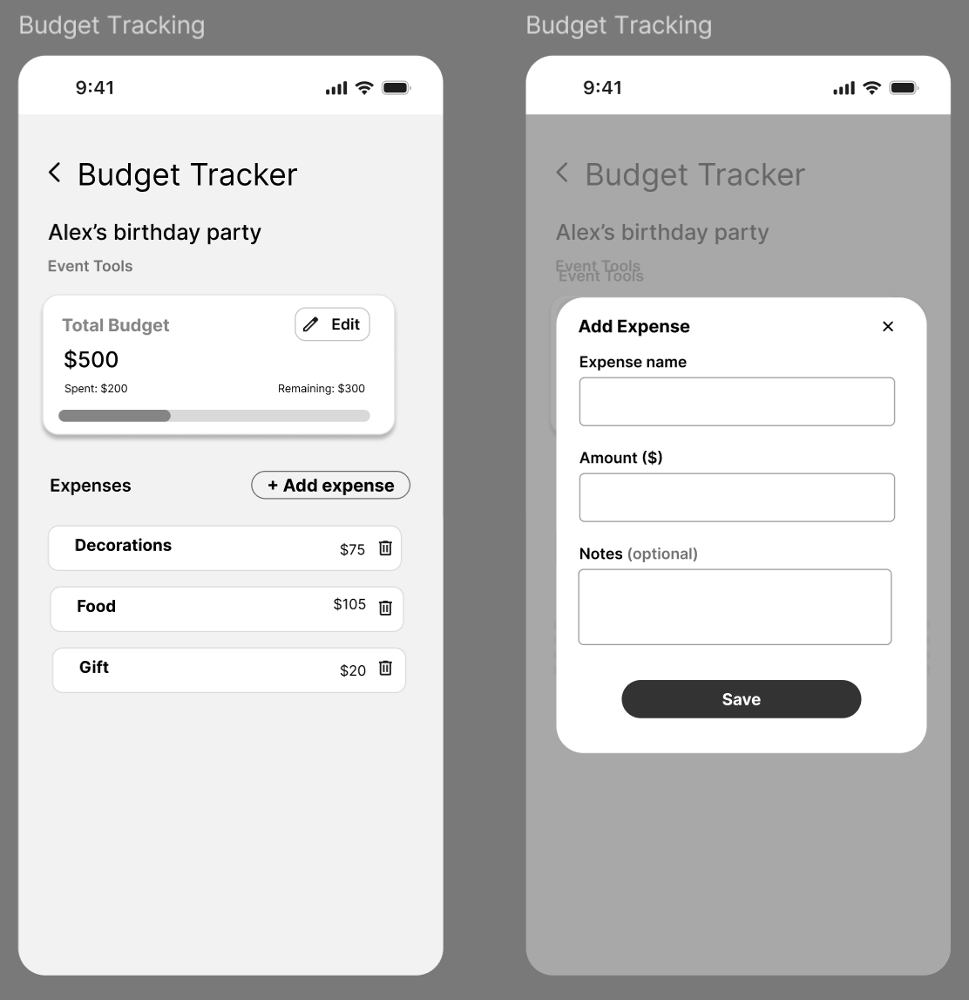

### My events view
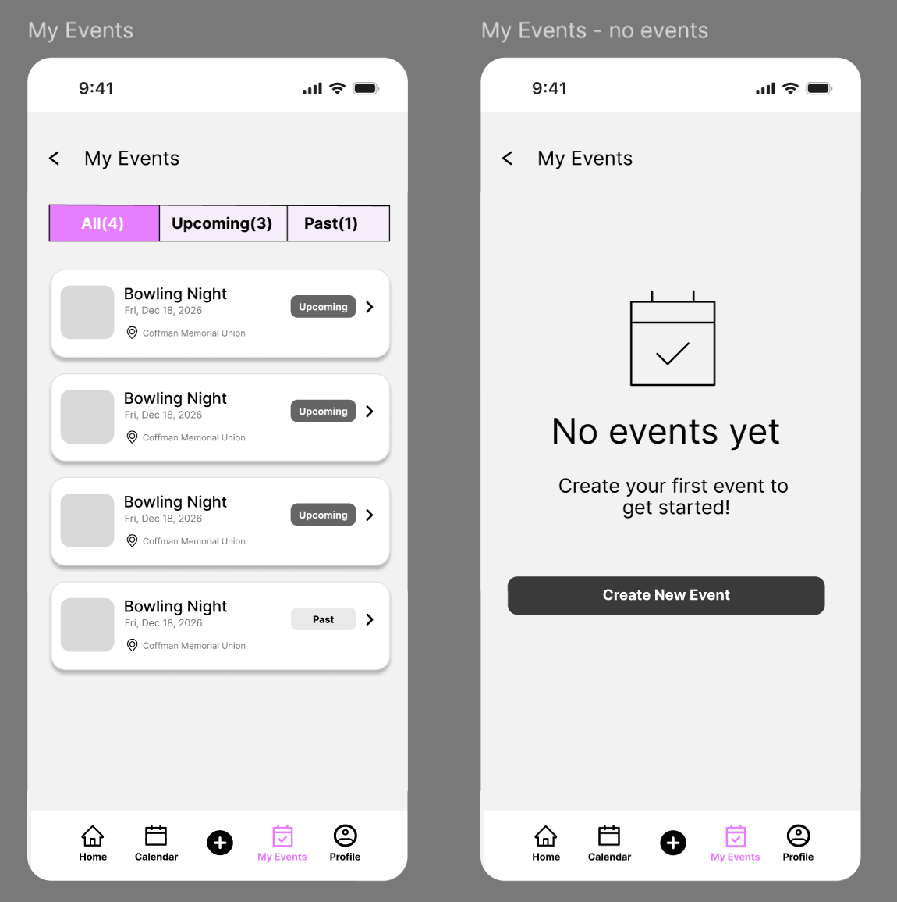

### Profile and logout
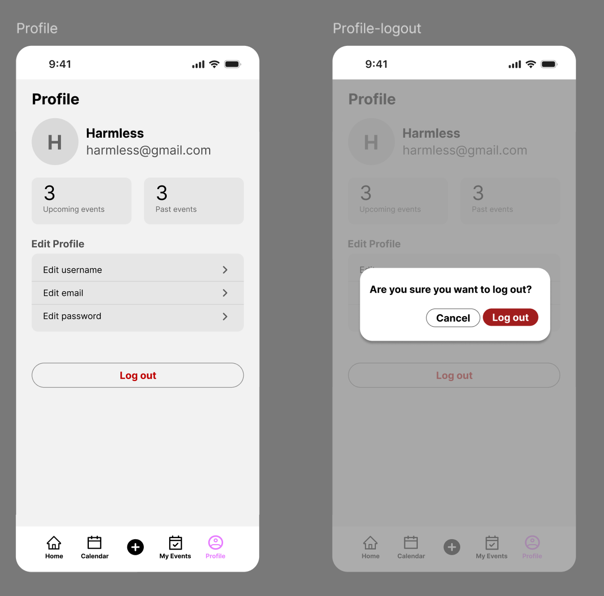

## Testing Notes

**Is there anything special we need to know in order to effectively test your app? (optional):**

* ...

## Screenshots of Site (complete)

**[Add a screenshot of each key page](https://stackoverflow.com/questions/10189356/how-to-add-screenshot-to-readmes-in-github-repository)
along with a very brief caption:**

## External Dependencies

**Document integrations with 3rd Party code or services here.
Please do not document required libraries (e.g., VUE, Firebase, vuefire).**

* Library or service name: description of use
* ...

**If there's anything else you would like to disclose about how your project
relied on external code, expertise, or anything else, please disclose that
here:**

...
